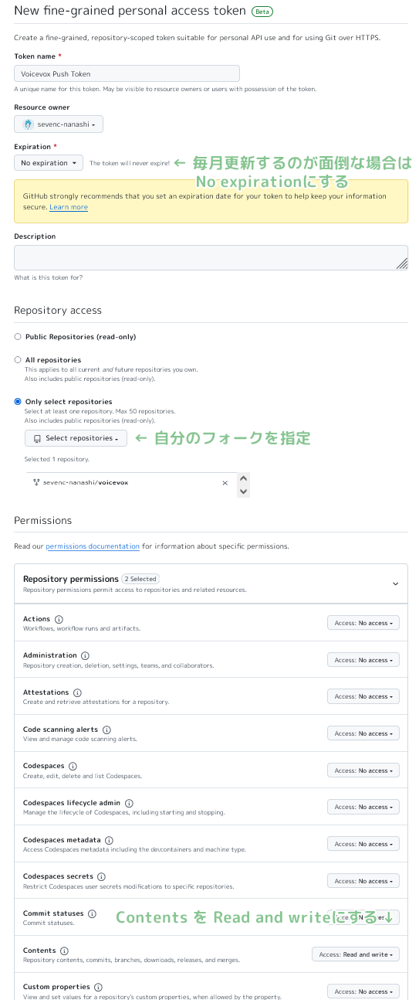

# VOICEVOX

[](https://github.com/VOICEVOX/voicevox/releases)
[](https://github.com/VOICEVOX/voicevox/actions/workflows/build.yml)
[](https://github.com/VOICEVOX/voicevox/actions/workflows/test.yml)
[](https://discord.gg/WMwWetrzuh)

这是 [VOICEVOX](https://voicevox.hiroshiba.jp/) 的编辑器。

（引擎详见 [VOICEVOX ENGINE](https://github.com/VOICEVOX/voicevox_engine/) ，核心详见 [VOICEVOX CORE](https://github.com/VOICEVOX/voicevox_core/) ，整体架构详见[这里](./docs/全体構成.md)。）

## 致用户

这里是开发用页面。关于使用方法，请查看 [VOICEVOX 官方网站](https://voicevox.hiroshiba.jp/)。

## Linux Arm

请下载分卷文件（part-000，part-001）并使用
```bash
cat voicevox-linux-cpu-arm64-0.26.3.tar.gz.part-* | tar xzf -
```
解压使用

## 致想为项目做贡献的人

VOICEVOX 项目欢迎感兴趣的人参与。我们准备了[说明贡献流程的指南](./CONTRIBUTING.md)。

提到贡献，人们往往容易想到编写程序，但其实有编写文档、生成测试、参与改进提案讨论等多种参与方式。也有新手欢迎任务，期待大家的参与。

VOICEVOX 编辑器使用了 Electron、TypeScript、Vue、Vuex 等技术，整体架构较难理解。[代码导览](./docs/コードの歩き方.md)介绍了其结构，希望能对开发有所帮助。

创建解决 Issue 的拉取请求时，为避免与他人处理同一 Issue，请在 Issue 侧说明已开始处理，或先创建 Draft 拉取请求。

在 [VOICEVOX 非官方 Discord 服务器](https://discord.gg/WMwWetrzuh)上进行开发讨论和闲聊。欢迎随时加入。

### 设计指南

请参考[UX・UI 设计方针](./docs/UX・UIデザインの方針.md)。

## 环境搭建

请安装 [.node-version](.node-version) 中记载版本的 Node.js。
使用 Node.js 的管理工具（[nvs](https://github.com/jasongin/nvs)、[nvm](https://github.com/nvm-sh/nvm) 等）可以轻松安装，还能自动切换 Node.js。

安装 Node.js 后，请 Fork [此仓库](https://github.com/VOICEVOX/voicevox.git) 并执行 `git clone`。

### 安装依赖库

执行以下命令会安装、更新依赖库。

```bash
npm i -g pnpm # 仅首次
pnpm i
```

### AI 代理的设置（可选）

执行以下命令，会设置 Codex CLI、Claude Code 等 AI 代理用的文件。

```bash
pnpm run setup-agents
```

## 运行

### 准备引擎

复制 `.env.example` 并创建 `.env`，在 `VITE_DEFAULT_ENGINE_INFOS` 内的 `executionFilePath` 中指定[产品版 VOICEVOX](https://voicevox.hiroshiba.jp/) 内的 `vv-engine/run.exe` 即可运行。

在 Windows 上如果未更改安装位置，请指定 `%LOCALAPPDATA%/Programs/VOICEVOX/vv-engine/run.exe`。请注意路径分隔符是 `/` 而不是 `\`。

如果使用面向 macOS 的 `VOICEVOX.app`，请指定 `/path/to/VOICEVOX.app/Contents/Resources/vv-engine/run`。

在 Linux 上，请指定从 [Releases](https://github.com/VOICEVOX/voicevox/releases/) 获取的 tar.gz 版中包含的 `vv-engine/run` 命令。如果是 AppImage 版，可以用 `$ /path/to/VOICEVOX.AppImage --appimage-mount` 挂载文件系统。

如果除了运行 VOICEVOX 编辑器之外，还单独启动了引擎 API 服务器，则无需指定 `executionFilePath`，但需要将 `executionEnabled` 改为 `false`。启动产品版 VOICEVOX 时也是如此。

如果要更改引擎 API 的目标端点，请更改 `VITE_DEFAULT_ENGINE_INFOS` 内的 `host`。

### 运行 Electron

```bash
# 在易于开发的环境下运行
pnpm run electron:serve

# 在接近构建时的环境下运行
pnpm run electron:serve --mode production

# 指定参数运行
pnpm run electron:serve -- ...
```

语音合成引擎的仓库在这里 <https://github.com/VOICEVOX/voicevox_engine>

### 运行 Storybook

可以使用 Storybook 开发组件。

```bash
pnpm run storybook
```

main 分支的 Storybook 可以从 [VOICEVOX/preview-pages](https://github.com/VOICEVOX/preview-pages) 查看。
<https://voicevox.github.io/preview-pages/preview/editor/branch-main/storybook/index.html>

### 运行浏览器版（开发中）

另外启动语音合成引擎，执行以下命令并访问显示的 localhost。

```bash
pnpm run browser:serve
```

另外，main 分支的构建结果已部署到 [VOICEVOX/preview-pages](https://github.com/VOICEVOX/preview-pages)。
<https://voicevox.github.io/preview-pages/preview/editor/branch-main/editor/index.html>
目前需要在本地 PC 上启动语音合成引擎。

## 构建

```bash
pnpm run electron:build
```

### 使用 Github Actions 构建

在 fork 的仓库中开启 Actions，并通过 workflow_dispatch 启动 `build.yml` 即可构建。构建产物会上传到 Release。

## 测试

### 单元测试

执行 `./tests/unit/` 下的测试以及 Storybook 的测试。

```bash
pnpm run test:unit
pnpm run test-watch:unit # 监视模式
pnpm run test-ui:unit # 显示 Vitest 的 UI
pnpm run test:unit --update # 更新快照
```

> [!NOTE]
> `./tests/unit` 下的测试，会根据文件名改变执行测试的环境。
>
> - `.node.spec.ts`：Node.js 环境
> - `.browser.spec.ts`：浏览器环境（Chromium）
> - `.spec.ts`：浏览器环境（通过 happy-dom 模拟）

### 浏览器端到端测试

执行不需要 Electron 功能的、UI 和语音合成等的端到端测试。

> [!NOTE]
> 部分重写引擎设置的测试，仅在 CI（Github Actions）上执行。

```bash
pnpm run test:browser-e2e
pnpm run test-watch:browser-e2e # 监视模式
pnpm run test-watch:browser-e2e --headed # 显示测试中的 UI
pnpm run test-ui:browser-e2e # 显示 Playwright 的 UI
```

由于使用了 Playwright，也可以生成测试模式。请在**已启动浏览器版的状态下**执行以下命令。

```bash
pnpm exec playwright codegen http://localhost:5173/ --viewport-size=1024,630
```

详情请参考 [Playwright 文档的 Test generator](https://playwright.dev/docs/codegen-intro)。

### Storybook 的视觉回归测试

比较 Storybook 组件的截图，如果有变更则显示差异。

> [!NOTE]
> 此测试只能在 Windows 上执行。

```bash
pnpm run test:storybook-vrt
pnpm run test-watch:storybook-vrt # 监视模式
pnpm run test-ui:storybook-vrt # 显示 Playwright 的 UI
```

#### 更新截图

浏览器端到端测试和 Storybook 会进行视觉回归测试。目前 VRT 测试仅在 Windows 上进行。可以按以下步骤更新截图：

##### 使用 Github Actions 更新时

1. 在 fork 的仓库设置中启用 GitHub Actions。
2. 在仓库设置的 Actions > General > Workflow permissions 中选择 Read and write permissions。
3. 从 GitHub 的 Actions 选项卡选择「Test」工作流，点击「Run workflow」。
4. 选择要更新的分支，勾选「更新快照」并执行。

   也可以使用 gh 命令执行。

   ```bash
   gh workflow run test.yml -R (用户名)/voicevox --ref (分支名) -f update_snapshots=true
   ```

5. Github Workflow 完成后，更新后的截图会被提交。
6. 拉取后，推送空提交以重新执行测试。

   ```bash
   git commit --allow-empty -m "（重新执行测试）"
   git push
   ```

> [!NOTE]
> 通过创建令牌并添加到 Secrets，可以自动重新执行测试。
>
> 1. 访问 [Fine-granted Tokens](https://github.com/settings/personal-access-tokens/new)。
> 2. 输入合适的名称，授予对 `用户名/voicevox` 的访问权限，并在 Repository permissions 的 Contents 中选择 Read and write。
>    <details>
>    <summary>设置示例</summary>
>    
>    </details>
> 3. 创建令牌并复制字符串。
> 4. 打开 `用户名/voicevox` 仓库的 Settings > Secrets and variables > Actions > New repository secret。
> 5. 在名称中输入 `PUSH_TOKEN`，粘贴之前的字符串以添加 Secrets。

##### 本地更新时

只更新与本地 PC 操作系统对应的内容。

```bash
pnpm run test:browser-e2e --update-snapshots
```

### Electron 端到端测试

执行需要 Electron 功能的、包括引擎启动、停止等的端到端测试。

```bash
pnpm run test:electron-e2e
pnpm run test-watch:electron-e2e # 监视模式
```

## 生成依赖库的许可证信息

依赖库的许可证信息会在 Github Workflow 构建时自动生成。可以使用以下命令生成。

```bash
# 从 voicevox_engine 获取 licenses.json 作为 engine_licenses.json

pnpm run license:generate -o voicevox_licenses.json
pnpm run license:merge -o public/licenses.json -i engine_licenses.json -i voicevox_licenses.json
```

## 代码格式化

整理代码格式。请在发送拉取请求前执行。

```bash
pnpm run fmt
```

## Lint（静态分析）

对代码进行静态分析，防患于未然。请在发送拉取请求前执行。

```bash
pnpm run lint
```

执行 lint 后，仓库根目录会生成缓存文件 `.eslintcache`。当 ESLint 升级、设置变更或缓存损坏时，请删除此文件。

## 拼写检查

使用 [typos](https://github.com/crate-ci/typos) 进行拼写检查。

```bash
pnpm run typos
```

可以执行拼写检查。如果有误判或应该从检查中排除的文件，请按照[配置文件的说明](https://github.com/crate-ci/typos#false-positives) 编辑 `_typos.toml`。

## 类型检查

进行 TypeScript 的类型检查。

```bash
pnpm run typecheck
```

## Markdownlint

进行 Markdown 的语法检查。

```bash
pnpm run markdownlint
```

## Shellcheck

进行 ShellScript 的语法检查。安装方法请参考[这里](https://github.com/koalaman/shellcheck#installing)。

```bash
shellcheck ./build/*.sh
shellcheck ./tools/*.bash
```

## GitHub Actions 的 lint

使用 [jactionlint](https://github.com/jdx/jactionlint) 检查 GitHub Actions 的工作流和 composite action。

```bash
pnpm run jactionlint
```

如果安装了 [ShellCheck](https://github.com/koalaman/shellcheck)，`run:` 中的 shell 脚本也会被检查。检查内容在 `.github/jactionlint.yaml` 中设置。

## 固定 GitHub Actions 的版本

使用 [pinact](https://github.com/suzuki-shunsuke/pinact) 将 GitHub Actions 的版本固定为 full-length commit SHA。

```bash
# 固定版本
pinact run

# 更新并固定版本
pinact run --update --min-age 7
```

## OpenAPI generator

请在[开发版 VOICEVOX ENGINE](https://github.com/voicevox/voicevox_engine) 已启动的状态下执行以下命令。

```bash
pnpm run generate-openapi
```

### OpenAPI generator 的版本升级

确认、安装新版本可以使用以下命令。

```bash
pnpm exec openapi-generator-cli version-manager list
```

## 在 VS Code 中调试运行

在 npm scripts 的 `serve` 或 `electron:serve` 等开发构建下，构建使用的 vite 会输出 sourcemap，因此源代码与输出代码会建立对应关系。

通过复制 `.vscode/launch.template.json` 为 `.vscode/launch.json`，复制 `.vscode/tasks.template.json` 为 `.vscode/tasks.json`，即可启用从 VS Code 运行开发构建并进行调试的任务。

## 许可证

采用 LGPL v3 与无需公开源代码的另一许可证的双许可证。如需获取另一许可证，请向ヒホ（Hiroshiba）申请。
X 账号：[@hiho_karuta](https://x.com/hiho_karuta)
